# BASINSHIFT — Phase 0 Engineering Audit & Implementation Plan

**System Identity:** HYDRAFORGE — Automated Evaluation Engine for the BASINSHIFT Challenge  
**Date of Audit:** 2026-11-04  
**Auditor:** Principal Software Architect & Senior ML Infrastructure Engineer  
**Status:** PHASE 0 COMPLETE — RECONNAISSANCE & IMPLEMENTATION BLUEPRINT  
**Target Delivery Window:** 4.0 Hours  

---

## 1. Executive Summary

This engineering audit assesses the readiness of the BASINSHIFT evaluation platform ("HYDRAFORGE") designed to evaluate participant machine-learning models and forecasting agents for extreme river-discharge prediction and high-flow event detection in geographically unfamiliar catchments.

The evaluation platform must operate as an automated, organizer-controlled, dataset-agnostic, and secure benchmark engine. It must rigorously protect hidden ground-truth evaluation labels while assessing participant submissions across six designated dimensions:
1. **Forecast skill** (provisional weight: 25%)
2. **High-flow event detection** (provisional weight: 25%)
3. **Out-of-distribution generalization** (provisional weight: 20%)
4. **Calibration and uncertainty** (provisional weight: 15%)
5. **Robustness** (provisional weight: 10%)
6. **Efficiency** (provisional weight: 5%)

### Inspection Highlights
1. **Workspace State:** Greenfield workspace (`C:\Users\DIVYANK BHARDWAJ\Desktop\Projects\HYDRAFORGE\HYDRAFORGE`) initialized with an empty Git repository tracking `https://github.com/DIVYANK-BHARDWAJ/HYDRAFORGE.git` on branch `main` (0 commits).
2. **Challenge Documentation:** The complete 22-page official specification (`BASINSHIFT_Full_Challenge_Documentation.pdf`, Version 1.0 Draft, dated 3 November 2026) was located, thoroughly parsed, and archived into `docs/`.
3. **Host Runtime Environment:** Python 3.11.9 is available with core scientific libraries pre-installed (`numpy 2.4.6`, `scipy 1.17.1`, `pandas 3.1.0`, `pyarrow 26.0.1`, `torch 2.15.0`, `xgboost 3.2.0`, `psutil 7.2.2`, `pytest 9.2.0`, `Flask 3.1.3`, `rich 15.0.0`). Docker CLI 29.6.2 is present, but the Docker daemon is currently inactive (`npipe:////./pipe/docker_engine` not found).
4. **Scoring & Evaluation Scaffold:** No prior evaluation codebase, metric functions, test suites, or benchmark dataset files existed in the workspace.
5. **Readiness Determination:** **CONDITIONAL READY FOR RAPID PHASED BUILD.** To achieve a functional, reproducible, and verifiable evaluation platform within the 4-hour window, we must construct a modular, pure-Python architecture with dual-mode execution isolation (Docker when daemon is active, hardened subprocess runner with strict memory/timeout sandboxing as fallback).

---

## 2. Project Directory Structure & Artifact Inventory

### 2.1 Current Physical Structure
```text
C:\Users\DIVYANK BHARDWAJ\Desktop\Projects\HYDRAFORGE\HYDRAFORGE\
├── .git\                                  # Initialized Git repository (empty, 0 commits)
│   ├── config                             # Remote origin: https://github.com/DIVYANK-BHARDWAJ/HYDRAFORGE.git
│   └── HEAD                               # refs/heads/main
└── docs\
    ├── BASINSHIFT_Full_Challenge_Documentation.pdf  # 22-page official challenge master specification
    └── PHASE_0_ENGINEERING_AUDIT.md       # This audit report
```

### 2.2 Framework & Dependency Identification
- **Backend Framework:** None currently initialized in the repo. Host contains Python 3.11.9, Flask 3.1.3, and standard ASGI/WSGI components.
- **Frontend Framework:** None in repo. Host contains Node.js v24.14.0.
- **Core ML / Scientific Stack:** PyTorch 2.15.0, XGBoost 3.2.0, Scipy 1.17.1, NumPy 2.4.6, Pandas 3.1.0, PyArrow 26.0.1, Chronos 2.3.2.
- **Architectural Selection:** We will establish a modular Python package (`hydraforge`) with a deterministic CLI entry point (`python -m hydraforge.cli`). For the UI/leaderboard, we will generate static interactive HTML reports and terminal Rich tables, avoiding heavy frontend overhead within the 4-hour constraint.

---

## 3. Existing Implemented Features vs. Missing Modules

| Component / Subsystem | Status | Details |
|---|---|---|
| Challenge Specification | **Complete** | PDF ingested, verified, and mapped to software requirements. |
| Participant Schema & Validator | **Missing** | No schema definition for participant inputs or outputs. |
| Benchmark Data & Splits | **Missing** | No catchment time series, attributes, or split manifests exist. |
| Scoring Engine | **Missing** | No implementation of the 6 evaluation metric dimensions. |
| Baselines Suite | **Missing** | No reference models (Persistence, Climatology, GBDT, Sequence). |
| Execution Sandbox Runner | **Missing** | No runner to clone, isolate, execute, and monitor participant code. |
| Security & Isolation Controls | **Missing** | No secret/label masking, no network blocker, no resource limiter. |
| Verification Test Suite | **Missing** | Zero unit or integration tests exist in the workspace. |
| Audit / Leaderboard Pipeline | **Missing** | No pipeline to aggregate run artifacts into an auditable leaderboard. |

---

## 4. Comprehensive Categorized Findings

### P0: Critical Blockers (Blocks a Working or Safe Evaluation)
1. **[P0-1] Complete Absence of Evaluation Engine & Schema:**
   - *Finding:* The repository contains zero executable Python code, schemas, or runner scripts.
   - *Impact:* Submissions cannot be accepted, parsed, executed, or scored.
   - *Remedy:* Scaffold the `hydraforge` package structure with Pydantic/dataclass schema contracts for prediction records, inputs, and evaluation outcomes.

2. **[P0-2] Inactive Docker Daemon on Windows Host:**
   - *Finding:* `docker info` indicates the Docker daemon is not running (`failed to connect to the docker API at npipe:////./pipe/docker_engine`).
   - *Impact:* Relying solely on Docker for submission isolation will cause immediate platform crashes on this host.
   - *Remedy:* Implement a dual-mode execution runner (`SubmissionRunner`):
     - `ContainerizedRunner`: Uses Docker when the daemon is accessible.
     - `HardenedSubprocessRunner`: Native fallback using temporary directories, strict read-only input mounting, isolated environment variable scrubbing, `psutil` memory caps, wall-clock timeouts, and hidden-label filesystem separation.

3. **[P0-3] Absence of Benchmark Inputs and Hidden Ground-Truth Labels:**
   - *Finding:* No physical Caravan or hydrological dataset exists in the workspace. The challenge documentation notes that Caravan is the target reference, but data files have not been staged.
   - *Rule Check:* Rule 4 strictly forbids fabricating real benchmark data or falsely claiming that hidden datasets exist.
   - *Remedy:*
     1. Build an official benchmark schema and ingestion interface supporting standard Caravan Parquet/NetCDF/CSV structures.
     2. Implement a deterministic synthetic benchmark dataset generator (`hydraforge.data.synthesizer`) based on established hydrological mass-balance dynamics (rainfall-runoff convolution, snowmelt, baseflow recession) to create standard verifiable development and test partitions (Train, Val, Test A, Test B, Test C) for platform testing.
     3. Provide an explicit staging directory (`data/benchmarks/`) ready to ingest genuine Caravan downloads when provided by the organizers.

4. **[P0-4] Lack of Hidden-Label Protection & Leakage Controls:**
   - *Finding:* In an automated evaluation system, participant code executes dynamically. If the ground-truth directory or test labels are located in reachable path structures, untrusted participant code can scan the parent filesystem.
   - *Remedy:* The evaluation architecture must enforce strict separation:
     - Participant processes receive *only* the test input directory (`inputs/`) containing catchment attributes, forecast origins, and past hydrological/meteorological history up to time $t$.
     - Hidden ground truth labels (`labels/`) remain in an organizer-protected directory never mounted or visible to the participant process.
     - Predictions are written to an isolated staging volume (`outputs/`) and evaluated post-execution by the independent scoring engine.

5. **[P0-5] Git Submission Provenance & Verification:**
   - *Finding:* Without strict commit SHA pinning, participants could alter code after submission, or mutable tags (e.g., `main`) could produce non-reproducible evaluation runs.
   - *Remedy:* Enforce immutable 40-character commit SHAs, clone with `--depth 1` at the exact SHA, verify cryptographic hashes of all submitted files, and log git commit metadata into the evaluation manifest.

---

### P1: Essential for Scientific Validity and Fair Scoring
1. **[P1-1] Undefined Extreme-Flow Threshold Semantics:**
   - *Finding:* Section 8.3 requires both `high_flow_probability` and `extreme_flow_probability`, but exact statistical thresholds are not explicitly frozen.
   - *Remedy / Proposal:* Establish statistical reference thresholds computed exclusively from the historical reference training period:
     - High-flow threshold $T_{high}(c) = 95\text{th percentile of } q(c, \le t_{train})$.
     - Extreme-flow threshold $T_{extreme}(c) = 99\text{th percentile of } q(c, \le t_{train})$.
     - *Requires Organizer Approval.*

2. **[P1-2] Bounded Normalization for Negative Forecast Skill (NSE/KGE):**
   - *Finding:* Standard Nash-Sutcliffe Efficiency (NSE) is defined as $1 - \frac{\sum (y - \hat{y})^2}{\sum (y - \bar{y})^2}$, which ranges from $-\infty$ to $1.0$. If a participant model produces erratic outputs, raw NSE would introduce massive negative scores, destabilizing the 25-point Forecast Skill weight.
   - *Remedy / Proposal:* Implement bounded normalized skill relative to a baseline anchor (persistence/climatology):
     $$\text{Skill}_{\text{norm}} = 25 \times \max\left(0.0, \frac{\text{NSE} - \text{NSE}_{\text{baseline}}}{1.0 - \text{NSE}_{\text{baseline}}}\right)$$
     with fallback to bounded Normalized Mean Absolute Error ($\text{NMAE} = \frac{\text{MAE}}{\bar{y}}$) mapped to $[0, 25]$.
     - *Requires Organizer Approval.*

3. **[P1-3] Scoring Metric Implementation for All 6 Dimensions:**
   - *Finding:* Full mathematical formulation needed for:
     - **Dimension 1 (Skill, 25 pts):** Continuous forecast accuracy (MAE, bounded NSE/KGE) averaged across forecast horizons ($h \in \{1, 3, 7\}$ days).
     - **Dimension 2 (Event Detection, 25 pts):** AUPRC and F1/recall at high-flow ($Q_{95}$) and extreme-flow ($Q_{99}$) thresholds.
     - **Dimension 3 (OOD Generalization, 20 pts):** Generalization ratio: $\text{Score}(Test\_B) / \text{Score}(Validation)$ across unseen catchments, plus penalty for high inter-basin variance.
     - **Dimension 4 (Calibration & Uncertainty, 15 pts):** Brier Score for exceedance probabilities + Empirical Coverage Error ($|\text{Coverage}_{90\%} - 0.90|$) and interval width penalty.
     - **Dimension 5 (Robustness, 10 pts):** Relative performance retention under Test C perturbations (missing historical discharge, sensor noise, reporting latency): $\text{Skill}(Test\_C) / \text{Skill}(Test\_A)$.
     - **Dimension 6 (Efficiency, 5 pts):** Measured wall-clock runtime per 1,000 predictions, peak RSS memory consumption, and model weight artifact size on disk.

4. **[P1-4] Catchment-Level vs. Pooled Aggregation:**
   - *Finding:* A large river with large discharge values could dominate pooled global MAE.
   - *Remedy:* Compute metrics per catchment (macro-averaging) and report both macro-mean, macro-median, interquartile range (IQR), and pooled statistics.

---

### P2: Important Engineering Improvements
1. **[P2-1] Reference Baseline Suite:**
   - Implement 4 organizer baselines required by Section 9.1:
     - *Baseline 1: Persistence* (predicts $q(c, t)$ for all future horizons $t+h$).
     - *Baseline 2: Climatology / Seasonal Mean* (day-of-year historical mean).
     - *Baseline 3: Gradient Boosted Decision Tree (LightGBM/XGBoost)* on lagged meteorology and static catchment attributes.
     - *Baseline 4: Neural Sequence Model (LSTM / GRU)* in PyTorch.
2. **[P2-2] Comprehensive Input Validation & Fault Tolerance:**
   - Schema enforcement to reject malformed JSON, NaN/inf values, negative discharge forecasts, and inverted prediction intervals ($upper < lower$).
3. **[P2-3] Deterministic Stress-Testing Scenarios (Test C):**
   - Fixed perturbation recipes:
     - Scenario C1: Discharge history fully masked (ungauged basin test).
     - Scenario C2: Meteorological input noise (10% additive Gaussian noise).
     - Scenario C3: 48-hour reporting delay in forcing data.

---

### P3: Polish & Observability
1. **[P3-1] Rich CLI & Terminal Dashboard:**
   - Rich terminal tables showing real-time execution progress, memory consumption, latency, and dimensional score breakdowns.
2. **[P3-2] Static HTML & JSON Leaderboard Export:**
   - Output structured evaluation artifacts: `evaluation_summary.json`, `leaderboard.md`, and an interactive standalone HTML visualization.
3. **[P3-3] Cryptographic Provenance Manifest:**
   - SHA-256 digests of test inputs, participant code commits, prediction outputs, and scoring parameters logged into an immutable `manifest.json`.

---

## 5. Dataset and Benchmark Readiness Assessment

### 5.1 Hydrological Reference: Caravan
- **Specification:** Global large-sample dataset spanning 6,830 catchments (streamflow, ERA5-Land forcings, HydroATLAS attributes).
- **Physical Availability in Workspace:** 0 catchments currently present.
- **Data Governance Policy (Section 6):**
  - Dataset-agnostic training: Participants may train on any legally permissible dataset (CAMELS, Caravan, GRDC, GloFAS reanalysis, national gauges).
  - Disclosure requirements: Provenance, licenses, preprocessing, variables, and pretrained weights must be declared.
  - Evaluation parity: Every participant must be tested on the exact same unseen organizer-controlled evaluation inputs and hidden labels.

### 5.2 Split Strategy (Section 7)
| Partition | Catchments | Time Range | Visibility | Purpose |
|---|---|---|---|---|
| **Training (Train)** | Set $\mathcal{C}_{train}$ | Historical $t \le T_1$ | Public | Participant model fitting |
| **Validation (Val)** | Set $\mathcal{C}_{train}$ | Intermediate $T_1 < t \le T_2$ | Public | Model validation & hyperparameter tuning |
| **Test A (Temporal)** | Set $\mathcal{C}_{train}$ | Hidden Future $t > T_2$ | Hidden | Temporal extrapolation in familiar basins |
| **Test B (Geographic)** | Set $\mathcal{C}_{unseen}$ | All periods $t > T_1$ | Hidden | Zero-shot geographic transfer to unseen basins |
| **Test C (Stress)** | Mixed holdouts | Perturbed windows | Hidden | Robustness to missing history, noise, latency |

---

## 6. Security & Threat Model Audit

| Threat Vector | Severity | Mitigation Architecture |
|---|---|---|
| **Arbitrary Code Execution** | Critical | Execute participant entrypoints in constrained subprocess or container with no elevated privileges. |
| **Label Leakage / File Scanning** | Critical | Mount *only* `inputs/` directory. Keep `labels/` in distinct, unshared memory/directory accessed solely by the scoring process. |
| **Inference-Time Network Exfiltration** | Critical | Disable network access during evaluation (`--network none` in Docker, `HTTP_PROXY=block` + loopback binding in subprocess). |
| **Resource Abuse (DoS / Fork Bomb)** | High | Process supervisor with memory ceiling (e.g., 4GB RAM) via `psutil`, CPU thread pinning, and execution timeout (e.g., 180s per catchment). |
| **Submission Tampering** | High | Clone repository at immutable 40-character commit SHA; compute and log SHA-256 hashes of all prediction files. |
| **Data Poisoning / Invalid Outputs** | Medium | Strict Pydantic schema validation; reject or penalize NaNs, infs, negative flows, and interval reversals. |

---

## 7. Explicit Assumptions Requiring Organizer Approval

The following specific design decisions and parameters are identified from the challenge document as requiring formal organizer approval:

1. **Threshold Definitions:**
   - *Proposal:* High-flow threshold = 95th empirical percentile of training discharge; Extreme-flow threshold = 99th empirical percentile.
2. **Forecast Horizons:**
   - *Proposal:* Daily discharge at $h = 1, 3, 7$ days ahead (aligned with Section 8.1 provisional set).
3. **Skill Metric Formula:**
   - *Proposal:* Bounded NSE normalized against Persistence baseline: $\max\left(0.0, \frac{\text{NSE} - \text{NSE}_{persist}}{1.0 - \text{NSE}_{persist}}\right) \times 25$.
4. **Interval Quality Nominal Coverage:**
   - *Proposal:* Prediction intervals must represent a 90% central credible interval ($\alpha = 0.10$). Calibration score penalizes $|Coverage - 0.90|$ plus excess interval width.
5. **Multi-Horizon Weighting:**
   - *Proposal:* Equal weighting across horizons: $\frac{1}{3} h_1 + \frac{1}{3} h_3 + \frac{1}{3} h_7$.
6. **Execution Resource Budget:**
   - *Proposal:* Standard evaluation allotment of 2 CPU cores, 4 GB RAM, and a hard timeout of 300 seconds per submission evaluation suite.

---

## 8. Master Implementation Plan (Remaining 4-Hour Budget)

```mermaid
gantt
    title HYDRAFORGE 4-Hour Implementation Timeline
    dateFormat  HH:mm
    axisFormat  %H:%M
    
    section Phase 1: Core & Schema
    Scaffold package & Pydantic schemas    :p1_1, 00:00, 25m
    Deterministic metric suite (6 dims)    :p1_2, after p1_1, 20m
    
    section Phase 2: Benchmark & Baselines
    Benchmark generator & split manager     :p2_1, after p1_2, 25m
    Reference baselines (Persistence, GBDT) :p2_2, after p2_1, 20m
    
    section Phase 3: Secure Sandbox Runner
    Subprocess & Docker execution runner    :p3_1, after p2_2, 30m
    Label isolation & hash verification    :p3_2, after p3_1, 15m
    
    section Phase 4: CLI & Orchestration
    HydraForge CLI commands                :p4_1, after p3_2, 20m
    Leaderboard & report generation         :p4_2, after p4_1, 15m
    
    section Phase 5: Verification & Audit
    End-to-end integration tests           :p5_1, after p4_2, 25m
    Verification of edge cases & report     :p5_2, after p5_1, 15m
```



### Phase Breakdown & Deliverables

#### Phase 1: Core Architecture, Schema & Metric Engine (45 min)
- **Target Files:**
  - `hydraforge/__init__.py`
  - `hydraforge/schema.py` (Pydantic models for Input, Prediction, Score, Evaluation Manifest)
  - `hydraforge/metrics/forecast_skill.py` (MAE, RMSE, Bounded NSE/KGE)
  - `hydraforge/metrics/event_detection.py` (High/Extreme flow AUPRC, Recall, Precision, Brier Score)
  - `hydraforge/metrics/generalization.py` (Unseen basin ratio, regional dispersion)
  - `hydraforge/metrics/calibration.py` (Empirical coverage error, interval width sharpness)
  - `hydraforge/metrics/robustness.py` (Relative degradation under Test C perturbations)
  - `hydraforge/metrics/efficiency.py` (Latency, memory tracking, artifact size)
  - `hydraforge/metrics/evaluator.py` (Master scoring engine aggregating 100 points)
  - `tests/test_schema.py`
  - `tests/test_metrics.py`

#### Phase 2: Benchmark Generation & Reference Baselines (45 min)
- **Target Files:**
  - `hydraforge/data/synthesizer.py` (Deterministic hydrological physics-based benchmark generator)
  - `hydraforge/data/splits.py` (Train, Val, Test A, Test B, Test C split manager)
  - `hydraforge/baselines/persistence.py` (Persistence baseline model)
  - `hydraforge/baselines/climatology.py` (Day-of-year seasonal baseline)
  - `hydraforge/baselines/gbdt.py` (XGBoost/LightGBM tabular lag baseline)
  - `tests/test_benchmark_splits.py`
  - `tests/test_baselines.py`

#### Phase 3: Secure Submission Runner & Sandbox Isolation (45 min)
- **Target Files:**
  - `hydraforge/runner/isolation.py` (Filesystem isolation, environment scrubbing, label shielding)
  - `hydraforge/runner/subprocess_runner.py` (Hardened subprocess execution with psutil monitoring & timeout)
  - `hydraforge/runner/docker_runner.py` (Containerized execution when daemon is active)
  - `hydraforge/runner/git_verifier.py` (Immutable commit SHA cloning and hash verification)
  - `tests/test_runner_isolation.py`

#### Phase 4: CLI, Orchestrator & Leaderboard Exporter (35 min)
- **Target Files:**
  - `hydraforge/orchestrator.py` (Full pipeline orchestrator: clone -> execute -> validate -> score -> report)
  - `hydraforge/cli.py` (Typer/Click CLI: `run`, `score`, `validate`, `generate-benchmark`)
  - `hydraforge/reports/leaderboard.py` (JSON, Markdown, and Rich terminal output)
  - `tests/test_orchestrator.py`

#### Phase 5: End-to-End Verification, Stress Testing & Demonstration (40 min)
- Execute complete test suite with `pytest`.
- Run mock participant submissions (perfect model, degraded model, baseline model, malformed model).
- Verify label isolation (confirm participant code cannot access hidden test labels).
- Produce final demonstration report and benchmark verification log.

---

## 9. Conclusion & Go/No-Go Recommendation

- **Reconnaissance Conclusion:** The BASINSHIFT specification provides a rigorous and scientifically sound foundation. The repository is greenfield and clean.
- **Feasibility:** Delivering a complete, reproducible, and verifiable evaluation platform within 4 hours is fully achievable by focusing on clean, modular Python architecture, dual-mode execution isolation, and deterministic numerical scoring.
- **Recommendation:** **PROCEED TO PHASE 1 IMMEDIATELY UPON APPROVAL.**

