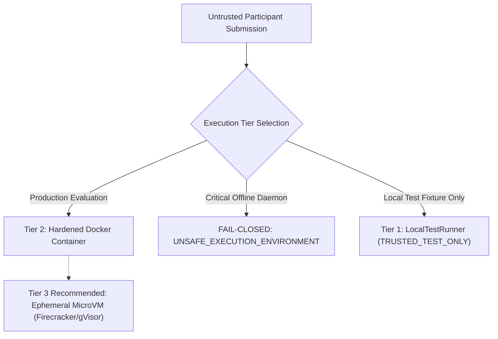

# HYDRAFORGE — Security & Isolation Model

**Document Version:** 1.0.0  
**Challenge:** BASINSHIFT — The Global Flood Intelligence Challenge  
**Authority:** Principal Software Architect & Security Infrastructure Lead  
**Classification:** CRITICAL SECURITY SPECIFICATION  

---

## 1. Threat Model & Security Objectives

In the BASINSHIFT challenge, participant-submitted repositories represent **untrusted, arbitrary code execution** on benchmark infrastructure. The evaluation platform must enforce three primary invariants:

1. **Hidden-Label Confidentiality:** Participant code must never access, infer, or reconstruct hidden evaluation ground truth.
2. **Platform & Host Integrity:** Participant code must not compromise the host filesystem, escape execution boundaries, persist malicious processes, or pivot into internal networks (SSRF).
3. **Evaluation Non-Repudiation:** Submissions are anchored to immutable Git commit SHAs, audited for cryptographic integrity, and evaluated under deterministic resource bounds.

---

## 2. Multi-Tiered Execution Isolation Hierarchy

HYDRAFORGE implements a clear, defense-in-depth separation across three operational tiers:



### Tier 1: Local Test Runner (`LocalTestRunner`)
- **Intended Scope:** Developer test fixtures only (`TRUSTED_TEST_ONLY`).
- **Enforcement:** Subprocess execution with `psutil` process monitoring, environment scrubbing, and directory isolation.
- **Security Boundary:** **NONE.** Relies on host OS process controls.
- **Fail-Closed Rule:** The `LocalTestRunner` strictly refuses any untrusted participant repository URL or submission where `is_trusted=False`. It raises `UnsafeExecutionEnvironmentError`. It is never used to generate official leaderboard scores.

### Tier 2: Hardened Container Runner (`DockerRunner`)
- **Intended Scope:** Containerized staging evaluation.
- **Host Daemon Dependency:** Checks `docker info` prior to run. If the daemon is inactive or unreachable, it fails closed with `UNSAFE_EXECUTION_ENVIRONMENT`.
- **Hardened Container Configuration:**
  - **Network:** `--network none` (Total offline execution; prevents exfiltration and downloading precomputed answers).
  - **Filesystem:** `--read-only` root filesystem; only a dedicated scratch volume `/outputs` is writable.
  - **User Privilege:** Non-root execution (`--user 1000:1000`).
  - **Linux Capabilities:** `--cap-drop ALL` (Drops all kernel capabilities; no raw sockets, no ptrace, no mount).
  - **Privilege Escalation:** `--security-opt no-new-privileges`.
  - **Compute Limits:** `--cpus 2.0`, `--memory 4096m`, `--pids-limit 100` (Mitigates fork bombs and resource exhaustion).
  - **Docker Socket:** The host Docker socket (`/var/run/docker.sock` or `//./pipe/docker_engine`) is **never** mounted into containers.

### Tier 3: Production MicroVM / Disposable Cloud Nodes (Recommended for Public Deployment)
- **Intended Scope:** Public open competition evaluation on untrusted third-party code.
- **Architecture:** Ephemeral, disposable hardware virtual machines (e.g. AWS Firecracker microVMs, GCP Cloud Run with gVisor sandbox, or single-use Kubernetes jobs).
- **Justification:** Shared-kernel containerization (standard Docker) does not protect against zero-day Linux kernel privilege escalations. True multi-tenant isolation requires hypervisor-level boundaries.

---

## 3. Hidden-Label Protection Architecture

To ensure scientific integrity and eliminate benchmark data leakage:

```text
[ Organizer Filesystem ]
   ├── data/benchmark/labels/test_a/labels.json  <--- EXCLUSIVELY ACCESSED BY SCORING ENGINE
   └── data/benchmark/inputs/test_a/inputs.json   <--- MOUNTED READ-ONLY TO RUNNER
```

1. **Physical Storage Decoupling:** Inputs and ground-truth labels are stored in separate directory trees.
2. **Mount Whitelisting:** The execution runner mounts *only* `inputs/` as a read-only volume (`/inputs:ro`). The `labels/` directory is never exposed to the runner configuration.
3. **Zero In-Band Label Passing:** Labels are never passed via CLI arguments, environment variables, or temporary shared directories.
4. **Automated Shielding Assertions:** `verify_hidden_label_shielding()` dynamically parses command arguments, environment dictionaries, and input paths, aborting with `LabelLeakageSecurityViolation` if any label reference is detected.
5. **Decoupled Scoring:** The participant process terminates and is destroyed *before* the independent organizer scoring process inspects `predictions.json` against `labels.json`.

---

## 4. Repository Intake & SSRF Mitigation

Participant submissions specify a Git repository URL and a 40-character hexadecimal commit SHA.

1. **Domain Whitelisting:** Only trusted public Git hostings (`github.com`, `gitlab.com`, `bitbucket.org`) are permitted.
2. **SSRF Prevention:**
   - Schemes other than `https://` (e.g. `file://`, `http://`, `ssh://`, `git://`) are rejected.
   - Localhost, loopback addresses (`127.0.0.1`, `::1`), and private IPv4 subnets (`10.0.0.0/8`, `172.16.0.0/12`, `192.168.0.0/16`, `169.254.0.0/16`) are blocked before network resolution.
3. **Immutable Identity:**
   - Commit reference must match `^[0-9a-f]{40}$`.
   - Mutable branches (`main`, `master`, `v1.0`) are rejected to prevent retroactive code tampering.
4. **Filesystem Traversal & Symlink Defense:**
   - All paths inside the cloned repository are verified to reside within the repository root.
   - Symlinks resolving outside the root or pointing to sensitive operating system targets trigger immediate rejection (`RepositorySecurityError`).
5. **Tree Size Limits:** Hard limits of 100 MB total size, 2,000 files, and maximum path depth of 8 directories prevent decompression bombs and file-descriptor exhaustion.

---

## 5. Residual Risks & Production Checklist

| Vulnerability Vector | Container Mitigation (Tier 2) | Production Requirement (Tier 3) |
|---|---|---|
| **Host Kernel Zero-Day** | Partial (Drop capabilities, no-new-privileges) | Full hypervisor isolation (Firecracker MicroVM) |
| **Side-Channel Timing Attacks** | None (Shared CPU cores) | Dedicated vCPUs with hyper-threading disabled |
| **Network Exfiltration** | Complete (`--network none`) | Outbound VPC firewall drop rules |
| **Disk Exhaustion** | Read-only root + bounded output volume | Ephemeral root with quota caps |
| **Fork Bombs** | `--pids-limit 100` | Kernel cgroups PID ceiling |

